  

  

  

  
  
  

  
  
  

## 👋 Hey, I'm Fayaz

> *"I want to ship products that are both intelligent and usable, not just models that live in notebooks."*

Third-year **Computer Science** student at **St. Peter's Engineering College, Hyderabad**, working where **AI/ML** meets **full-stack development**.

| | |
|---|---|
| 🎯 **Focus** | AI/ML engineering · LLMs · Computer vision · Data-driven web apps |
| 🔭 **Building now** | An AI video proctoring system for college exams |
| 🏆 **Hackathon** | NASSCOM FutureSkills Prime GenAI Forge (2026) |
| 💼 **Experience** | Software Engineering Intern, Embrizon Technologies |
| 💬 **Ask me about** | MediaPipe · MERN apps · Flutter + Firebase · Text classification with scikit-learn |
| 📬 **Looking for** | AI/ML and software development internships |

## 🧭 Pick Your Path

> [!TIP]
> Short on time? Click what describes you and I'll point you to the best stuff.

<b>🧑‍💼 I'm a recruiter or hiring manager</b>

 

1. **[Live portfolio](https://fayaz-portfolio-gamma.vercel.app/)**: a quick overview of everything
2. **[AI Video Invigilation](#-currently-building)**: my most technical project (computer vision + a real-world workflow)
3. **[DataMind](https://github.com/Fayaz0267/DataMind)**: full-stack + AI in one product
4. **[LinkedIn](https://www.linkedin.com/in/shaik-mahammad-fayaz-1009bb338)** or **[email me](mailto:Shaikfayaz0267@gmail.com?subject=Internship%20opportunity)** to talk

<b>🛠️ I want to collaborate or build something</b>

 

I'm open to **hackathon teams, open source and research collaborations**. If your idea involves AI, computer vision or a web product people will really use, [send me a message](mailto:Shaikfayaz0267@gmail.com?subject=Let%27s%20build%20something). I reply fast.

<b>🏆 I'm a hackathon organizer or judge</b>

 

I took part in the **NASSCOM FutureSkills Prime GenAI Forge (2026)**. I like building end-to-end: model, backend, UI and deployment. Start with **[PayAI](https://github.com/Fayaz0267/PayAI)** and **[DataMind](https://github.com/Fayaz0267/DataMind)** to see how I ship.

## 🚧 Currently Building

### 🎥 AI Video Invigilation

A standalone AI proctoring module designed to plug into an existing college online-exam system.

```mermaid
flowchart LR
    A[📷 Webcam feed] --> B[🧠 MediaPipe<br/>face landmarks + gaze]
    B --> C[⚠️ Event detection<br/>gaze, secondary device]
    C --> D[📊 Risk score<br/>LOW to CRITICAL]
    D --> E[🧑‍🏫 Faculty dashboard<br/>events + evidence]
    E --> F[✅ Faculty makes<br/>the final call]

    style A fill:#0b1020,stroke:#22d3ee,stroke-width:2px,color:#ffffff
    style B fill:#150f3a,stroke:#8b5cf6,stroke-width:2px,color:#ffffff
    style C fill:#150f3a,stroke:#f472b6,stroke-width:2px,color:#ffffff
    style D fill:#150f3a,stroke:#f472b6,stroke-width:2px,color:#ffffff
    style E fill:#062a3a,stroke:#22d3ee,stroke-width:2px,color:#ffffff
    style F fill:#14532d,stroke:#4ade80,stroke-width:2px,color:#ffffff
```

> **Design principle:** the AI reports *events, confidence and evidence*; **faculty makes the final call**. No single detection is ever labeled "cheating", which keeps false positives low.

<!-- Add the repo link once public: [View repo →](https://github.com/Fayaz0267/YOUR_REPO_NAME) -->

## 🚀 Featured Projects

<table>
  <tr>
    <td width="50%" valign="top">
      <h3>🍽️ <a href="https://github.com/Fayaz0267/campuseats-frontend">CampusEats</a></h3>
      
Food ordering for college campuses with <b>real-time order tracking</b> and <b>role-based access</b> for students, vendors and admins.

      
      
      
      
    </td>
    <td width="50%" valign="top">
      <h3>📊 <a href="https://github.com/Fayaz0267/DataMind">DataMind</a></h3>
      
AI-powered analytics platform with interactive dashboards and <b>natural-language queries</b> over your data.

      
      
      
    </td>
  </tr>
  <tr>
    <td width="50%" valign="top">
      <h3>💳 <a href="https://github.com/Fayaz0267/PayAI">PayAI</a></h3>
      
Financial transaction and payment utility with smart payment workflows and <b>contextual AI insights</b>.

      
      
      
    </td>
    <td width="50%" valign="top">
      <h3>🗺️ <a href="https://github.com/Fayaz0267/Incredible_India">Incredible India</a></h3>
      
An immersive travel guide celebrating India's diverse geography, rich spirituality and world-renowned hospitality.

      
      
    </td>
  </tr>
  <tr>
    <td colspan="2" valign="top">
      <h3>🌐 <a href="https://fayaz-portfolio-gamma.vercel.app/">Personal Portfolio</a> · live</h3>
      
Responsive portfolio built for recruiters and hackathon judges, with dark/light theme and smooth Framer Motion animations.

      
      
      
      
    </td>
  </tr>
</table>

<b>➕ More projects</b>

 

- 🕵️ **AI-Based Fake Job Detection System**: ML mini project that flags fake job postings (Flask, TF-IDF, Logistic Regression)
- 🏢 **Community360**: apartment management app with a maintenance module (Flutter, Firebase)

## 🛠️ Tech Stack

<b>🤖 AI / ML</b>

  

  
  
  

<b>🌐 Full-Stack</b>

  

<b>📱 Mobile</b>

  

<b>⚙️ Tools & Deployment</b>

  

## 💼 Experience

**🏢 Software Engineering Intern** · Embrizon Technologies

<!-- Add the duration and 1-2 bullets on what you built or shipped, e.g. "Built X using Y, which did Z". -->

## 🏅 Certifications & Achievements

  
  
  

<b>More certifications and credential IDs</b>

 

**Credential IDs**
- GenAI Forge Hackathon (NASSCOM FutureSkills Prime): `FSP/2026/2702/272`
- Cloud Computing, Elite (NPTEL): `NPTEL26CS55S956200743`
- Software Engineering Intern (Embrizon Technologies): `ET2025IC1814`

**Other courses and workshops**
- HP LIFE: Strategic Planning in the AI Age
- Masters' Union: Build Your First AI App
- be10X: AI Tools & ChatGPT Workshop

## 📊 GitHub Stats

  
  

<b>🐍 Contribution snake (click to play)</b>

 

  <picture>
    <source media="(prefers-color-scheme: dark)" srcset="https://raw.githubusercontent.com/Fayaz0267/Fayaz0267/output/github-snake-dark.svg" />
    <source media="(prefers-color-scheme: light)" srcset="https://raw.githubusercontent.com/Fayaz0267/Fayaz0267/output/github-snake.svg" />
    
  </picture>

## 🤝 Let's Build Something

> [!IMPORTANT]
> I'm actively looking for **AI/ML and software development internships**. If you're working on something interesting, I'd love to hear about it.

<b>Open to:</b> Internships · Open Source · Hackathon Teams · Research Collaborations

  
  
  

  

