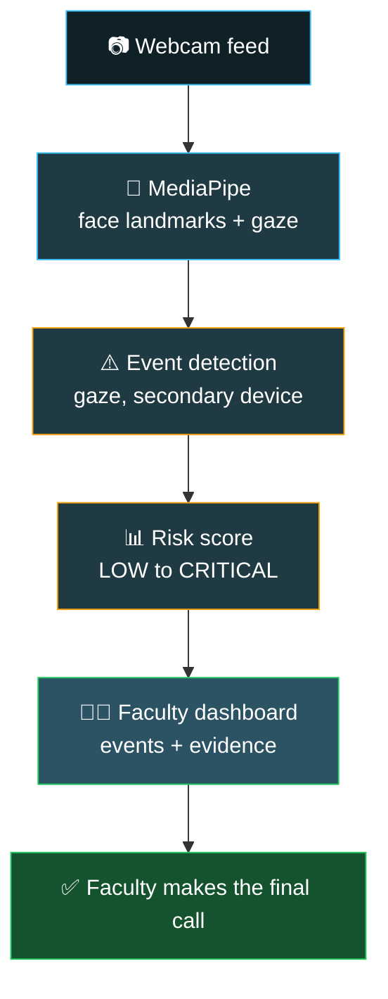

  

  

  
  
  

  
  
  
  

---

## 👨‍💻 About Me

> *"I want to ship products that are both intelligent and usable, not just models that live in notebooks."*

I'm a third-year **Computer Science undergraduate** at **St. Peter's Engineering College, Hyderabad**, working at the intersection of **AI/ML** and **full-stack web development**.

- 🎯 **Focus:** AI/ML engineering · LLMs · Computer vision · Data-driven web apps
- 🔭 **Now:** Building an AI video proctoring prototype and looking for AI/ML & SDE internships
- 🏆 **Hackathon:** NASSCOM FutureSkills Prime GenAI Forge (2026)
- 🌱 **Learning:** Better data, better models, better UX

---

## 🚧 Currently Building

### 🎥 AI Video Invigilation

A standalone AI proctoring module designed to plug into an existing college online-exam system.

> **Design principle:** the AI reports *events, confidence and evidence*; **faculty makes the final call**. No single detection is ever labeled "cheating", which keeps false positives low.

<!-- Add the repo link once public: [View repo →](https://github.com/Fayaz0267/YOUR_REPO_NAME) -->

---

## 🚀 Featured Projects

### 🍽️ [CampusEats](https://github.com/Fayaz0267/campuseats-frontend)

Food ordering platform for college campuses with **real-time order tracking** and **role-based access** for students, vendors and admins.

### 📊 [DataMind](https://github.com/Fayaz0267/DataMind)

AI-powered data analytics platform with an integrated AI analysis layer, interactive dashboards and **natural-language queries**.

### 💳 [PayAI](https://github.com/Fayaz0267/PayAI)

AI-integrated financial transaction and payment utility with smart payment workflows and contextual AI insights.

### 🗺️ [Incredible India](https://github.com/Fayaz0267/Incredible_India)

Tourism and itinerary planning platform with smart trip planning and location-based recommendations.

### 🌐 [Personal Portfolio](https://fayaz-portfolio-gamma.vercel.app/)

Responsive portfolio built for recruiters and hackathon judges, with dark/light theme and smooth Framer Motion animations.

---

## 🛠️ Tech Stack

<b>🤖 AI / ML</b>

  

  
  
  

<b>🌐 Full-Stack</b>

  

<b>⚙️ Tools & Deployment</b>

  

---

## 💼 Experience

**🏢 Software Engineering Intern** · Embrizon Technologies
 `Credential ID: ET2025IC1814`

---

## 🏅 Certifications & Achievements

  
  
  
  
  
  

<b>View credential IDs</b>

 

- GenAI Forge Hackathon (NASSCOM FutureSkills Prime): `FSP/2026/2702/272`
- Cloud Computing, Elite (NPTEL): `NPTEL26CS55S956200743`
- Software Engineering Intern (Embrizon Technologies): `ET2025IC1814`

---

## 📊 GitHub Stats

  

  

  

  

---

## 🤝 Let's Connect

I'm actively looking for **AI/ML and software development internships**. If you're building something interesting, I'd love to hear about it.

<b>Open to:</b> Internships · Open Source · Hackathon Teams · Research Collaborations

  
  

  

